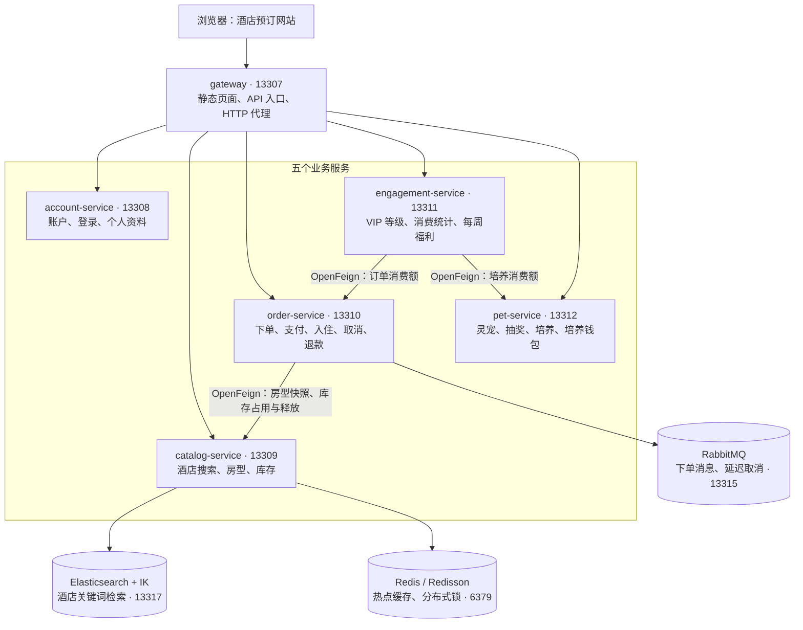
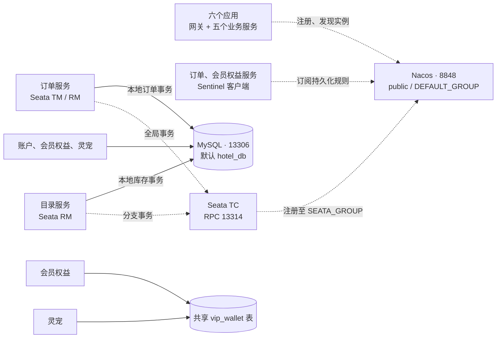
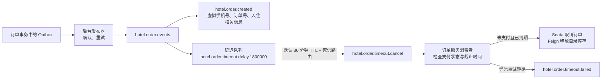
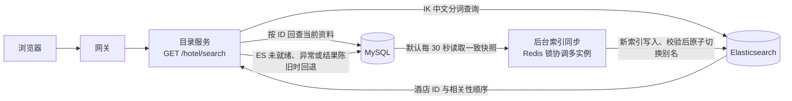
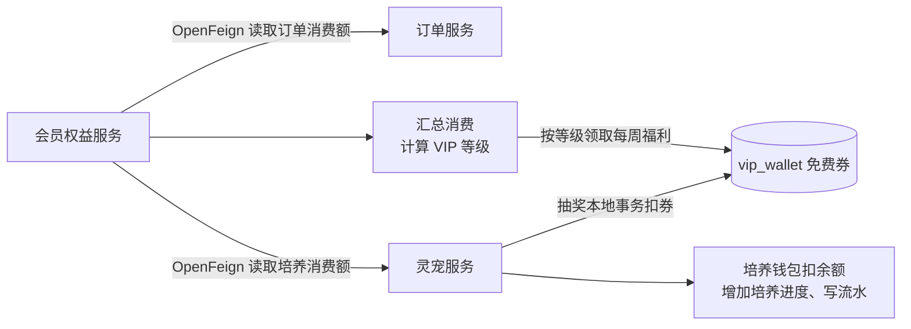

# 项目总结构与架构示意图

按当前仓库代码整理：项目采用 Maven 多模块，包含 **1 个网关、5 个业务服务、1 个公共依赖模块**。六个应用分别启动、注册到 Nacos；`service-support` 不独立启动。

技术基线：Java 17、Spring Boot 3.0.2、Spring Cloud 2022.0.0、Spring Cloud Alibaba 2022.0.0.0。下图表示代码中的依赖关系，不代表当前进程均已启动。

## 1. 总览：用户请求如何进入各个服务



这张图只画业务调用。数据存储、注册中心与事务协调关系见第 4 节。浏览器通过网关访问业务 API；业务服务之间的远程调用使用 OpenFeign。

## 2. 模块职责与入口

| 模块 | 默认端口 | 启动类 | 主要业务及网关路由 |
| --- | --- | --- | --- |
| `gateway` | 13307 | `GatewayApplication` | 提供 HTML/CSS/JS，转发 `/hotel/**` 请求 |
| `account-service` | 13308 | `AccountApplication` | 注册、登录、JWT、资料、密码；`/hotel/auth/**`、`/hotel/profile/**` |
| `catalog-service` | 13309 | `CatalogApplication` | 酒店搜索、房型查询、库存与库存占用记录；`/hotel/search`、`searchall`、`searchbyid`、`searchbyphone`、`searchroombyid`、`rooms/**` |
| `order-service` | 13310 | `OrderApplication` | 订单全流程、超时取消、库存释放、订单消费额；`/hotel/orders/**` |
| `engagement-service` | 13311 | `EngagementApplication` | 汇总订单与培养消费、计算 VIP 等级、发放每周福利；`/hotel/vip/**` |
| `pet-service` | 13312 | `PetApplication` | 孵化、抽奖、重新孵化、培养、培养余额及流水；`/hotel/pet/**`、`/hotel/wallet/**` |
| `service-support` | 无 | 无 | JWT 验证、安全配置、Feign 公共配置、库存共享类型与脚本；普通依赖 JAR |

目录服务也提供 `/internal/catalog/**`、`/internal/inventory/**`；订单和灵宠服务提供内部消费统计接口。内部接口供业务服务调用，不通过网关公开路由。

网关当前由 Spring MVC 控制器、Java HttpClient 和 Spring Cloud LoadBalancer 实现 HTTP 代理，实例信息来自 Nacos。

## 3. 工程目录：代码在哪里

```text
hotel-booking-system/
├─ pom.xml                         Maven 父工程、模块清单、统一依赖版本
├─ gateway/
│  └─ src/main/
│     ├─ java/.../GatewayController.java   网关路由与 HTTP 转发
│     └─ resources/static/         网页、图片、CSS、前端 JS
├─ account-service/                账户与认证
├─ catalog-service/                酒店目录与库存
│  └─ src/main/java/com/hotel/hotelbookingsystem/
│     ├─ controller/               HTTP 入口
│     ├─ service/                  查询业务
│     ├─ mapper/、entity/          数据库映射与实体
│     ├─ cache/                    Redis 热点缓存
│     ├─ inventory/                库存占用、释放、Redisson 锁
│     ├─ search/                   ES 查询、索引同步与数据库回退
│     └─ config/                   客户端与基础设施配置
├─ order-service/                  订单与交易编排
│  └─ src/main/java/com/hotel/hotelbookingsystem/
│     ├─ controller/               订单 HTTP 入口
│     ├─ service/                  订单业务、Seata 全局事务、旧库存迁移
│     ├─ client/                   CatalogClient、InventoryClient
│     ├─ inventory/                远程库存调用封装
│     ├─ messaging/                Outbox、消息发布、延迟取消消费者
│     └─ config/                   Sentinel、Seata、启动就绪检查等
├─ engagement-service/             VIP、消费统计、每周福利
├─ pet-service/                    灵宠与培养钱包
├─ service-support/                共用 config/、http/、inventory/
├─ elasticsearch/                  ES + IK Dockerfile、Compose
├─ rabbitmq/                       RabbitMQ Compose
├─ seata/                          Seata Compose 与服务端配置
├─ sentinel/                       三份持久化限流、熔断规则 JSON
├─ start-services.ps1              启动六个应用，日志写入 target/service-logs/
├─ publish-sentinel-rules.ps1       向 Nacos 发布 Sentinel 规则
├─ ARCHITECTURE.md                 本文：总结构与调用关系
├─ README.md                       详细配置、启动与验证说明
└─ ORDER-FLOW.md 等                订单、账户、VIP、灵宠、培养业务说明
```

各业务模块的 `src/main/resources/application.yml` 保存应用配置；SQL 初始化脚本位于各模块资源目录。根目录残留的 `src/` 不在当前 Maven 模块清单中；以六个应用的启动类为准。`target/` 为构建产物或运行日志。

## 4. 基础设施与数据关系



虚线表示注册、规则订阅或事务协调。Nacos 提供地址发现，业务请求在调用方与目标服务之间直接传输。

| 组件 | 默认本机端口 | 当前作用 |
| --- | --- | --- |
| MySQL | 13306 | 持久化业务数据；五个业务服务默认连接同一个 `hotel_db` |
| Nacos | 8848；客户端 gRPC 9848 | 六个应用的注册与发现；Sentinel 规则持久化 |
| Redis / Redisson | 6379 | 目录热点缓存、房型库存分布式锁、ES 索引同步锁 |
| Seata 1.7.0 | 控制台 13313；RPC 13314 | AT 模式协调订单与库存事务；当前 RPC 默认发布在 `127.0.0.2:13314` |
| RabbitMQ | AMQP 13315；管理台 13316 | 下单通知、未支付订单延迟取消、失败消息队列 |
| Elasticsearch 8.5.3 + IK 8.5.3 | HTTP 13317 | 酒店名称与地址检索；写入 `ik_max_word`，查询 `ik_smart` |
| Sentinel | 无独立监听端口 | 嵌入订单与会员权益服务；仓库没有单独部署 Sentinel 控制台 |

### 数据的逻辑归属

| 服务 | 主要业务表 |
| --- | --- |
| 账户 | `user` |
| 目录 | `hotel`、`room_type`、`room_inventory`、`room_reservation` |
| 订单 | `stay_order`、`order_outbox` |
| 会员权益 | `vip_week_claim`，与灵宠共享 `vip_wallet` |
| 灵宠 | `spirit_pet`、`spirit_pet_draw`、`account_wallet`、`account_transaction`，与会员权益共享 `vip_wallet` |

订单和目录还使用 `undo_log` 支持 Seata AT。以上是代码层面的业务归属，**当前默认配置尚未做到每个服务使用独立数据库**。虽然可通过各服务的数据库 URL 覆盖配置，会员发券与灵宠扣券目前仍依赖同一张 `vip_wallet` 表；其数据库不能直接独立拆开。

## 5. 核心链路：下单、库存、消息

```sequenceDiagram
    participant U as 浏览器 / 网关
    participant O as 订单服务
    participant T as Seata TC
    participant C as 目录服务
    participant R as Redis / Redisson
    participant D as MySQL
    participant M as RabbitMQ
    U->>O: POST /hotel/orders
    O->>C: OpenFeign 获取数据库房型快照
    C-->>O: 酒店、房型、价格
    Note over O,T: BookingTransactions 开启全局事务
    O->>D: 本地事务写入订单
    O->>C: OpenFeign 占用库存，传递 XID
    C->>R: 获取房型级分布式锁
    C->>D: 条件更新库存，写占用记录和 AT 日志
    C-->>O: 库存占用成功
    O->>D: 同一本地事务写通知与超时 Outbox
    O->>T: 提交全局事务
    Note over O,D: 任一分支失败时回滚订单和库存
    O-->>U: 返回待支付订单
    Note over O,M: 后台 Outbox 发布器在事务完成后投递
    O->>M: 下单通知 + 延迟取消消息，等待确认
```

- **防超卖**：目录服务按房型加 Redisson 锁，数据库以条件更新限制占用量；订单号与占用记录配合实现幂等。Redis 缓存不作为库存真值。
- **事务范围**：Seata 覆盖订单与目录库存；RabbitMQ 通过事务内 Outbox 与确认重试衔接，消息采用至少一次投递。
- **锁的范围**：Redisson 锁保护库存本地事务；Seata 全局事务后续阶段依靠数据库条件与全局锁协调。
- **演示库存模型**：每房型默认 10 间，按房型共享库存池；尚未按入住日期逐日维护可售库存。

### 未支付超时取消



已支付或已处理的订单不会重复取消，重复消息按订单状态幂等处理；定时任务补偿遗漏的超时订单。通知队列当前用于对接后续通知功能，尚未接入真实短信渠道。待支付通知中的实际入住时间与房号尚未生成。

## 6. 核心链路：酒店中文检索



MySQL 是酒店资料来源，ES 是搜索索引；同步存在默认约 30 秒的检查周期。房型、价格与库存按原有数据库流程读取，订单房型快照直接查库。Redis 热点缓存用于现有酒店、房型查询；分布式锁同时用于库存和索引重建协调。

## 7. 核心链路：会员权益与灵宠



会员权益的远程消费统计失败时返回不可用，避免错误计算等级或发券。灵宠培养扣余额与进度更新在本地事务内完成。

## 8. 启动与阅读顺序

基础设施先就绪：MySQL、Redis、Nacos，然后启动 Seata、RabbitMQ、Elasticsearch。业务启动脚本先导入 Sentinel 规则，依次启动账户、目录、订单、会员权益、灵宠，最后启动网关；其中会等待目录注册就绪，订单还包含旧库存迁移与就绪检查。

本机入口：网站 `http://localhost:13307/`；Nacos 控制台 `http://localhost:8848/nacos`；RabbitMQ 管理台 `http://localhost:13316/`。端口均可由配置中的环境变量覆盖。此文梳理代码结构，未对当前运行环境做启动健康检查。

建议阅读顺序：父 `pom.xml` → `GatewayController` → 目标服务控制器 → 业务 Service → Feign Client 或数据库访问 → 相关中间件配置。

详细配置与启动命令见 [README](README.md)，订单业务规则见 [ORDER-FLOW](ORDER-FLOW.md)，账户、VIP 与灵宠说明见 [ACCOUNT-AND-ORDERS](ACCOUNT-AND-ORDERS.md)、[VIP](VIP.md)、[SPIRIT-PET](SPIRIT-PET.md)、[CULTIVATION](CULTIVATION.md)。
